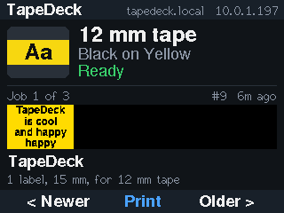

# TapeDeck

A web front end for a Brother P-touch label printer (PT-D600), running on an
M5Stack Core Basic with the M5Stack USB Module (MAX3421E) as the USB host.

- **Browser label editor**: what you see is what prints. Labels are drawn in the
  browser at the printer's 180 dpi and previewed in the colours of the cassette
  that's loaded (the printer reports tape width, tape colour and ink colour).
- **Batches**: any number of labels go out as one job with a cut between each,
  so you pay the ~20 mm leader once per batch instead of once per label. Bulk
  add takes one label per line.
- **Multi-line text, fonts, frames, inverted labels, fixed lengths, images**
  (scaled to the tape, threshold or dithered).
- **History**: the last 25 jobs are kept on the device for reprinting from the
  web page or from the Core's own buttons; jobs made in the editor can be
  loaded back in and edited.
- **HTTP API** for other apps and scripts: JSON text jobs rendered on the
  device, or ready-made 1-bit bitmaps (PBM). `tools/tapedeck.py` is a client.
- **Captive-portal Wi-Fi setup**, mDNS (`http://tapedeck.local/`), OTA updates.



## Hardware

- M5Stack Core Basic (ESP32, 16 MB flash)
- M5Stack USB Module v1.2 (MAX3421E) stacked on the Core. Its two DIP switches
  must be ON: **SS Select** on any channel (CH1 = G13, CH2 = G5, CH3 = G0) and
  **INT Select** on either (CH1 = G35, CH2 = G34). Both off (as shipped) means
  the module is electrically absent. The firmware finds both pins by itself.
- Brother PT-D600 plugged into the module's USB-A port, powered from its own
  adapter. Other 128-pin/180 dpi P-touch models that speak the same raster
  protocol (PT-P700, P750W, E550W ...) will probably work but are untested.

## Build and flash

PlatformIO with the pioarduino platform (PlatformIO Core 6.2+):

```bash
~/.platformio/penv/bin/pio run -e app -t upload --upload-port /dev/cu.usbserial-XXXX
```

Later updates can go over Wi-Fi from the Setup page, or:

```bash
curl -F fw=@.pio/build/app/firmware.bin http://tapedeck.local/update
```

`lib/M5-Max3421E-USBShield` is a vendored copy of M5Stack's TinyUSB fork with a
fix that printing depends on (see NOTES.md). Don't swap it back to the upstream
library.

## First run

With no network saved, the Core opens a setup Wi-Fi network called
`TapeDeck-XXXX` and shows a QR code for it. Join it from a phone. The setup page
opens by itself (or browse to `http://192.168.4.1/setup`). Pick your network,
enter the password, save. The Core joins it and its screen shows its address.
After that, use `http://tapedeck.local/`.

Without Wi-Fi the Core still works as a reprint station: press any button on
the setup screen to see the job history.

## The Core's buttons

| Button | Press | Hold |
| --- | --- | --- |
| A (left) | newer job | refresh the printer status |
| B (middle) | print the job shown (press twice to confirm) | info screen |
| C (right) | older job | jump to the newest job |

The screen shows the loaded tape as a coloured swatch with its width and
colours, the printer state (Ready, Printing 2 of 5, Cover open ...), and a
preview of the selected history job.

Holding B opens the info screen: a QR code for the label editor (or for
joining the setup network), the address and Wi-Fi details, and the tape colour
picker. There, A and C step through the colour presets, B saves, and holding B
leaves without saving.

## Tape colours

The PT-D600 reports the cassette's width and type but always reports its
colours as black on white, so you tell TapeDeck the colours: click the tape
chip at the top of the web page, or hold B on the Core.

Every choice is remembered (the last 8 cassettes, with their width and type).
When TapeDeck sees the cover open and close, or a different cassette type, it
assumes the tape you last used of that width and type, and asks you to check:

- the web page shows a **"Tape changed. Which one is it?"** bar with the tapes
  you've used before as one-click buttons (ones of the same width and type
  first), plus "Other colours…";
- the Core says "New tape? Hold B: colours"; the picker starts on the best
  guess and steps through your recent tapes before the full preset list.

Two cassettes of the same width and type look identical to the printer, which
is why it asks after every cover opening. The ✕ next to a recent tape in the
web picker forgets it.

## HTTP API

| Method | Path | |
| --- | --- | --- |
| GET | `/api/status` | printer state, tape width / printable dots / colours, job progress |
| POST | `/api/print` | print a job (body below); `/api/save` stores it without printing |
| GET | `/api/jobs` | history, newest first |
| GET | `/api/jobs/ID` | a job file (TDJ1) |
| POST | `/api/jobs/ID/print` | reprint |
| DELETE | `/api/jobs/ID` | remove from the history |
| GET | `/api/tape` | recent cassettes (this width + type first) and colour presets |
| POST | `/api/tape` | set the loaded cassette's colours: `preset=N`, or `tape=CODE&ink=CODE` (Brother codes) |
| POST | `/api/tape/forget` | drop a recent cassette: `tape`, `ink`, `width_mm`, `media_code` |

`/api/print` takes three kinds of body, told apart by their first bytes:

**JSON text job**, rendered on the device for the loaded tape:

```bash
curl -X POST http://tapedeck.local/api/print -H 'Content-Type: application/json' \
  -d '{"labels":["136078-1015\n27C512 U5","136078-1016\n27C512 U6"]}'
```

Per label (or at the top level as defaults): `text` (or `lines`), `font`
(`bold` default, `sans`, `mono`, `serif`), `size` (line height in dots; default
fits the tape), `align` (`left`, `center`, `right`), `length_mm`, `pad_mm`,
`frame`, `invert`, `copies`. Top level: `title`, `copies` (whole set),
`margin_mm`, `chain`, `print` (false = store only).

**PBM** (binary P4), printed exactly as given. Height is dots across the tape
(`print_dots` in the status: 24, 32, 50, 70, 112 or 128 for 3.5-24 mm), width is
the label length at 180 dpi. Options go in headers: `X-Title`, `X-Copies`.

```bash
curl -X POST http://tapedeck.local/api/print -H 'X-Title: logo' --data-binary @logo.pbm
```

**TDJ1 job file**: the editor's own format (see `include/jobfile.h`):
column-major 1-bit pages and a header with copies, margin and flags.

Request headers: `X-Print: 0` (store only), `X-Source`, `X-Tape-MM` (lay a JSON
job out for a tape that isn't loaded). If an API key is set in Setup, send it
as `X-API-Key`. Every reply is JSON with `ok`, the stored `job` and `queued`.

### Command-line client

```bash
tools/tapedeck.py status
tools/tapedeck.py text "136078-1015|27C512 U5" "136078-1016|27C512 U6"
tools/tapedeck.py text --font mono --frame --copies 3 "KEEP OUT"
tools/tapedeck.py image logo.png          # macOS: scaled to the tape with sips
tools/tapedeck.py jobs
tools/tapedeck.py reprint 12
```

Set `TAPEDECK_HOST` (default `tapedeck.local`) and `TAPEDECK_KEY` as needed.

## Serial console

115200 baud. `help` lists the commands: `status`, `jobs`, `print ID`, `text {json}`,
`wifi SSID PASS`, `btn a|b|c`, `shot` (screen dump) and others.
`tools/devcon.py` wraps them, including screenshots and job previews as PNG.
On a Mac, opening the port resets the Core; give it ~8 seconds to boot.

## License

MIT. The vendored USB host library is MIT (Adafruit / M5Stack / Ha Thach).
